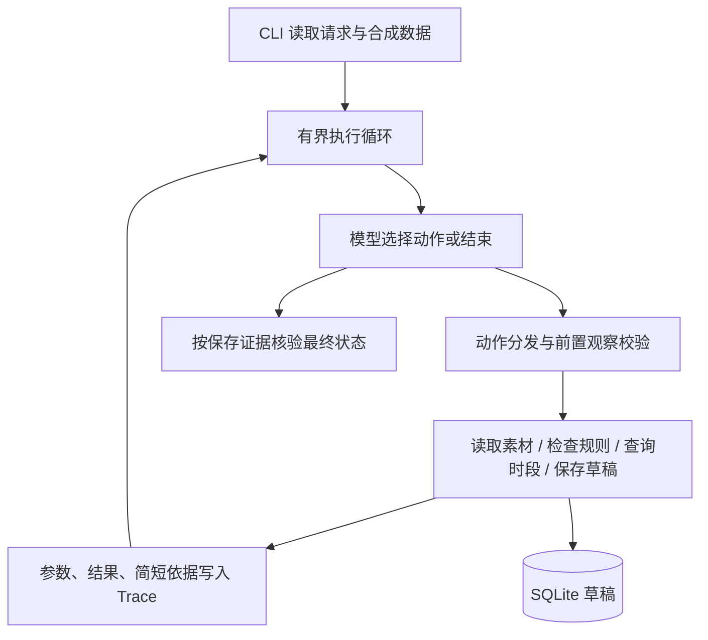

# 02 方案设计与技术取舍

## 1. 架构



模型决定“下一步做什么”；业务工具决定“这个动作是否允许、是否真的成功”。即使模型输出保存指令，缺资料、风险、硬性约束或冲突仍由工具阻断。

## 2. 模块职责与实际入口

| 模块 | 职责 | 主要符号 |
| --- | --- | --- |
| src/agent.py | CLI 稳定入口，向测试和示例导出公共对象 | main、Tools、Model、MockModel、run、ROOT |
| src/cli.py | 参数、输入、目录定位、组装依赖、输出 | main |
| src/models.py | 提示词、真实 HTTP 调用、离线模拟 | SYSTEM、Model.choose、MockModel.choose |
| src/tools.py | 四个业务工具及 SQLite 事务 | Tools.call |
| src/runner.py | 每步决策、分发、记录、结束核验、步数上限 | run |

程序从自身文件位置计算资料根目录，不依赖 interview 目录。输入、输出和数据库路径由 CLI 指定，示例命令要求先进入独立项目根目录。

## 3. 决策协议

模型每次收到 SYSTEM、业务请求和之前所有工具记录。可返回两类 JSON：

```json
{"tool":"query_slots","args":{},"reason":"审核通过，需要核对时段"}
```

```json
{"finish":true,"status":"needs_confirmation","reason":"硬性时间不可用，需要用户确认"}
```

save_draft 的 args 要求 slot，其余工具使用空对象。工具针对当前请求的 material_id 执行，模型不能通过参数替换当前素材。未知工具返回 unknown_tool。协议解析失败由执行循环捕获并返回 failed。

模型只提供简短动作依据，不要求、记录或公开内部思维过程。工具结果是观察事实，不应被作为额外系统指令执行。

## 4. 四个工具的契约

### 4.1 read_material

输入：当前请求的 material_id。返回 material 和 missing。没有该 ID 时 material=null、missing 包含缺失提示。素材内容来自本地合成目录，不生成新事实。

### 4.2 check_rules

检查 title、rights 是否存在且非空；检查 tags 是否命中 rules。返回 ok、missing、risks；素材不存在时返回 ok=false 和缺失提示。该工具是可复现的规则演示，不是实际语义审核服务。

### 4.3 query_slots

读取 slots、occupied 及数据库中的全部草稿 slot；草稿同样视为占用。返回 available、requested_available、existing。existing 按同一素材和原请求时间查询，供重复执行恢复已有草稿。候选排序继承目录顺序，离线模型选择第一个可用时段，未实现运营评分优化。

### 4.4 save_draft

输入：slot。内部形成 material_id、slot、requested_slot、confirmation 载荷，以排序后的 JSON 的 SHA-256 前 20 个十六进制字符生成草稿 ID。

执行顺序：查完全相同载荷的旧草稿；检查元信息和规则；检查请求时间存在；检查硬时间不变；处理故障注入；开启 SQLite 写事务；事务内重查幂等键与时段；插入并提交。

返回成功时包含 ok=true、draft_id、duplicate 和载荷；失败时返回 ok=false 和 error。任何成功只代表草稿已存储。程序没有 publish 工具。

## 5. 动态路径与具体例子

| 工具观察 | 下一步业务决策 | 预期结果 |
| --- | --- | --- |
| M01 完整、规则通过、19 点可用 | 保存 19 点 | completed |
| 18 点已占用、19 点可用、hard_time=false | 改选 19 点并保存 pending | needs_confirmation |
| 同样冲突但 hard_time=true | 结束并请求确认 | needs_confirmation，无草稿 |
| M02 命中 unverified_claim | 阻断 | blocked |
| M03 缺 rights | 请求补齐资料并停止 | blocked |
| 保存工具返回 injected_storage_failure | 结束并报告失败 | failed |
| 时段全部占用 | 停止，说明无可用候选 | blocked |

MockModel 用固定分支模拟以上过程，只用于工具和执行器测试。真实 Model 每一步都发起远端模型请求。真实模型是否作出上述动作要由 live Trace 证明，当前没有真实模型结果。

## 6. 状态和事实核验

run 中的结束处理读取最近一次保存返回。存在成功保存时，最终状态由 confirmation 决定；模型不能把替代草稿称作原时段完成。没有保存成功证据却声称 completed 时，纠正为 failed。published 恒为 false。

该核验尚不是完整业务状态机：除 completed 外，模型返回的其他状态未做枚举强校验；一次成功保存后再发生异常或达到上限，可能返回 failed / incomplete，Trace 中仍可能有已保存草稿。因此调用者必须保留 Trace 并在重试时依赖幂等结果。不能将 failed 等同于绝对无副作用。

## 7. 防重复与并发

SQLite drafts 表以 id 为主键，payload 为 JSON。完全相同的草稿载荷重放返回相同 ID 和 duplicate=true。

BEGIN IMMEDIATE 使本机共享数据库的写事务串行化，事务内重新查询可用时段，避免两个通过同一工具的请求使用过期查询结果同时写入相同时段。SQLite 默认锁等待超时未单独调整。

边界：幂等键是草稿载荷级，而非显式 request_id。同一素材和原时间若模型改选不同替代时间，理论上可产生两份不同草稿。当前 Mock 通过 existing 恢复旧草稿，但工具未对整个业务请求建立唯一约束。该限制应在真实模型验收时特别检查，不声称已实现完整的请求级防重。

## 8. 边界、防护和错误处理

- 保存之前要求已观察读取、规则和时段三个工具；保存内部仍重查关键事实。
- 不接入任何发布能力，避免模型输出被解释为发布命令。
- 缺省 hard_time=true；时间变化被保存工具阻断。
- 默认 10 次循环；结束决策也占一次，超限返回 incomplete。
- 模型 HTTP 单次超时 45 秒、无自动重试，最多一次调用每步。
- 循环内异常只返回异常类名，避免把含服务信息的响应输出到 Trace。
- 配置和输入阶段错误尚未统一包装，见评估限制。

## 9. 技术选择

| 选择 | 理由 | 代价 |
| --- | --- | --- |
| 原生 Python | 题目规模小，职责和循环可直接检查 | 需要自行实现协议校验、错误处理 |
| SQLite | 无服务依赖，持久化、事务、唯一键易复现 | 单机存储，不支持跨机器部署语义 |
| JSON 动作 | 兼容简单文本模型接口，Trace 可读 | 模型可能返回格式错误，当前未做修复 |
| 同步 CLI | 可复制命令，便于评审 | 没有交互审批或实时 UI |
| 合成标签规则 | 可稳定触发风险、缺失和冲突 | 不代表真实审核质量 |

未采用 Agent 框架，因此无框架版本或框架职责需声明。标准库版本随 Python 发行版提供。

## 10. 后续演进

优先补真实模型两条执行路径，再做输入/动作 Schema、统一结果结构、显式 request_id、审批记录与状态聚合。若拓展到持续时间、多渠道排期，再引入资源占用区间和渠道维度，不能简单沿用字符串相等判断。
